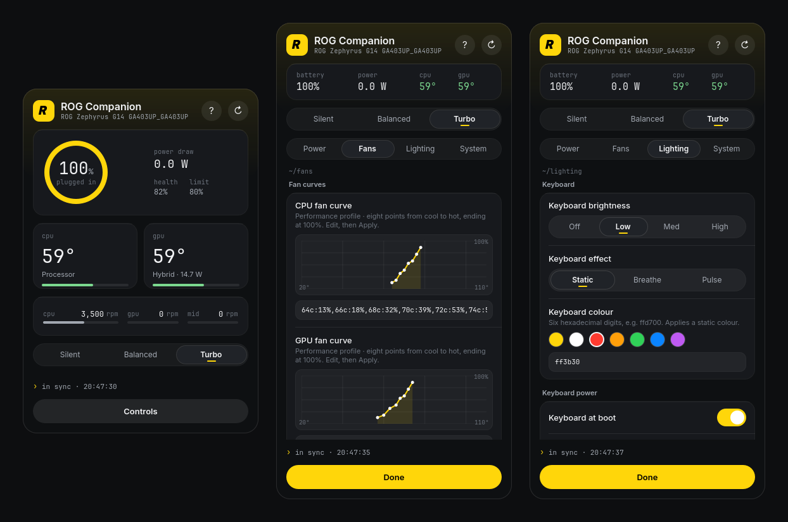
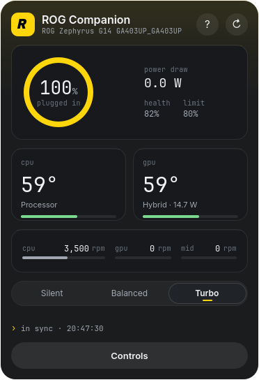
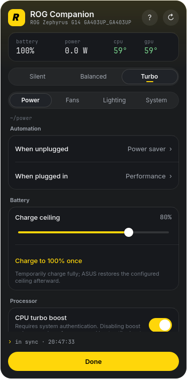
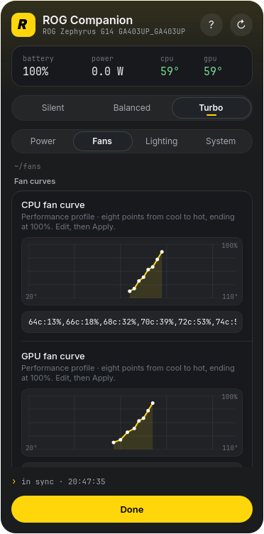
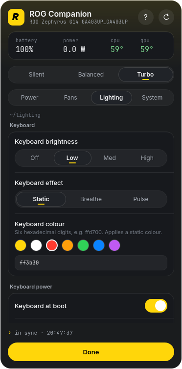
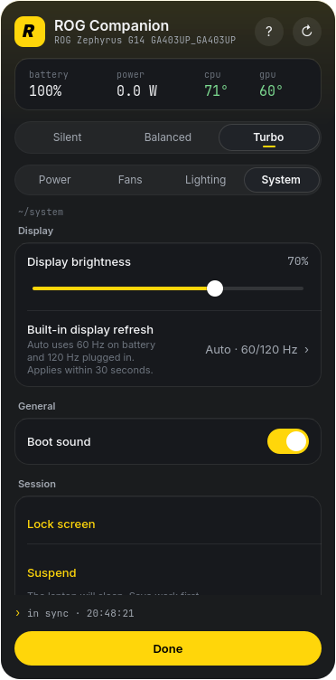
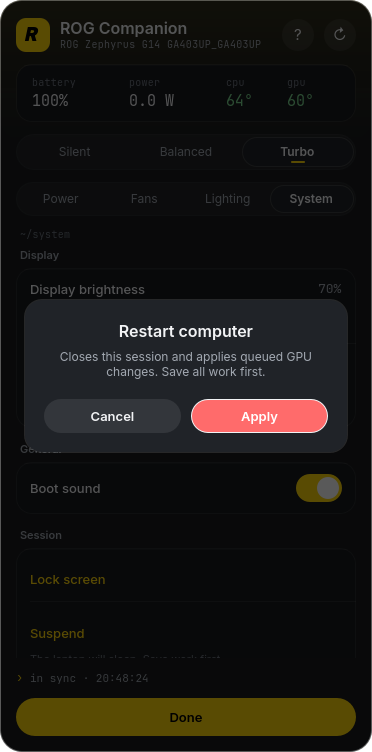
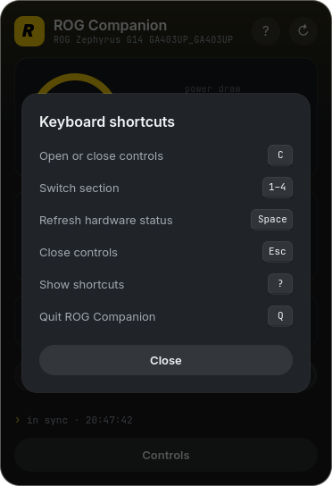
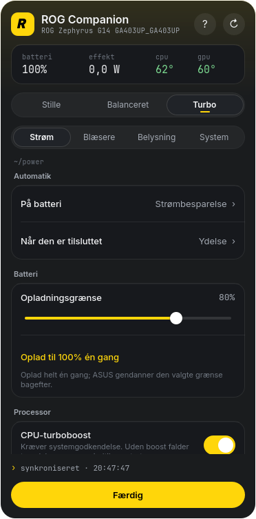

# ROG Companion

**An ASUS ROG laptop control panel for Linux.** Fans, performance mode, battery charge limit, GPU mode, keyboard and Slash lighting, all in a compact panel that sits on your desktop. Think G-Helper, built for Hyprland and Omarchy.



> Unofficial community project. Not made by or affiliated with ASUS. "ROG" is a trademark of ASUSTeK Computer Inc.

## Screenshots

| | | |
|:---:|:---:|:---:|
| <br>**At a glance:** battery ring, temperatures, fans and performance mode | <br>**Power:** automatic profiles, charge limit, CPU boost and GPU mode | <br>**Fans:** each curve drawn live as you edit it |
| <br>**Lighting:** brightness levels, effects, colour swatches and Slash bar | <br>**System:** brightness, automatic refresh rate, boot sound and session | <br>**Safe by design:** anything disruptive asks first |
| <br>**Keyboard first:** every action has a shortcut | <br>**Your language:** follows Omarchy's language setting live | |

## What it does

- **Live status:** battery, charge rate, battery health, CPU/GPU temperature and all fan speeds at a glance
- **Performance:** Silent / Balanced / Turbo, plus separate profiles for battery and plugged in
- **Battery care:** charge limit (20–100%) and one-off charge to 100%
- **Fans:** custom fan curves per profile, drawn as a live graph, with validation so you can't set an unsafe curve
- **GPU mode:** Hybrid, Integrated (Eco) or NVIDIA (Ultimate), queued safely for the next reboot
- **Display:** brightness, and automatic refresh rate (e.g. 60 Hz on battery, 120 Hz plugged in) using whatever rates your panel supports
- **Lighting:** keyboard brightness, effect and colour, keyboard power states, and Slash bar settings on models that have one
- **CPU boost** on/off through a tiny, audited root helper that can only write that one setting

Every change is **read back from the hardware** and reported as verified or not, so the panel never claims something worked when it didn't.

It follows your Omarchy theme colour and language live, uses your terminal font for every number, and works on any Wayland desktop with layer-shell support.

## Supported laptops

ROG Companion talks to [`asusctl`/`asusd`](https://asus-linux.org), so it supports the ROG and TUF laptops that `asusctl` supports. It shows only the controls your model actually has.

| Model | Status |
|---|---|
| ROG Zephyrus G14 (GA403UP, 2024) | ✅ Tested daily |
| Other ROG Zephyrus / Strix / Flow / TUF | 🧪 Should work. [Tell us how it goes!](https://github.com/Deltaharsha/rog-companion/issues/new?title=Tested+on+MODEL&body=Model:%0A%0AWhat+worked:%0A%0AWhat+didn't:%0A%0AOutput+of+%60rog-companion+status%60+and+%60rog-companion+controls%60:%0A) |

## Install

### Arch / Omarchy

Install the ready-built package from the [latest release](https://github.com/Deltaharsha/rog-companion/releases/latest). Pacman pulls in everything it needs from the official repos:

```sh
sudo pacman -U https://github.com/Deltaharsha/rog-companion/releases/download/v0.3.1/rog-companion-0.3.1-1-x86_64.pkg.tar.zst
systemctl --user enable --now rog-companion.service rog-companion-policy.service
```

Each release lists the package's SHA-256 checksum next to it. An AUR package is coming.

### From source

Needs `asusctl`, Qt 6 (base, declarative, wayland), `layer-shell-qt`, `power-profiles-daemon`, `brightnessctl`, `upower` and `python-gobject`.

```sh
git clone https://github.com/Deltaharsha/rog-companion
cd rog-companion
bin/install   # builds, tests and installs it as a package
systemctl --user enable --now rog-companion.service rog-companion-policy.service
```

## Use

The panel starts at login and sits in the bottom-right corner. Click **Open controls**, or launch **ROG Companion** from your app launcher to bring it forward.

Safe settings (profile, lighting, brightness, toggles) apply the moment you touch them. Anything that can interrupt you, like GPU mode, fan curves, charging to 100% or restarting, asks first.

| Key | Action |
|---|---|
| C | Open or close controls |
| 1–4 | Switch section |
| Space | Refresh |
| Escape | Close controls |
| ? | Show shortcuts |
| Q | Quit |

From a terminal or script:

```sh
rog-companion status            # all readings as JSON
rog-companion controls          # every control, and why any are unavailable on your model
rog-companion set charge 80     # change a setting; prints JSON, exits 0 or 1
```

## Good to know

- **Opening the panel never writes to your hardware.** Only touching a control does.
- **GPU mode changes need a reboot.** The panel shows what's queued separately from what's active.
- **GPU mode changes are applied safely on restart.** The package replaces asusd's `asus-shutdown` helper, which can hang the restart after switching to Eco. [Details and opt-out](contrib/eco-restart-fix).
- **Fan curves** need eight points with rising temperatures, ending at 100% speed.
- **Firmware power limits** are shown for reference when your laptop reports them. Changing them isn't supported yet.
- Hardware details for the tested model are in [HARDWARE.md](HARDWARE.md).

## Development

```sh
bin/build    # build into build/
bin/test     # backend and interface tests, offscreen
bin/install  # package and install this working copy
```

C++ owns the hardware logic (`src/backend.cpp`), QML owns the layout (`src/Main.qml`). Translations live in `src/i18n/`.

## Support the project

ROG Companion is free and open source. If it saves you from booting into Windows for Armoury Crate, a ⭐ on GitHub helps other ROG owners find it. Also check out [dotdoctor](https://github.com/Deltaharsha/dotdoctor), a checkup tool for your Linux desktop config.

## License

MIT. The bundled [Inter](https://rsms.me/inter/) typeface is under the SIL Open Font License (`src/fonts/Inter-OFL.txt`).
